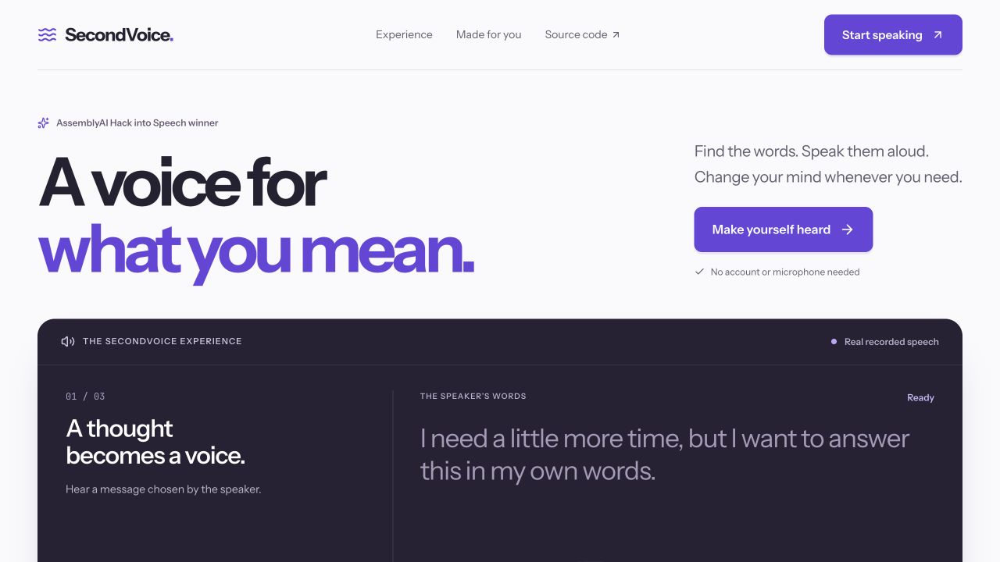
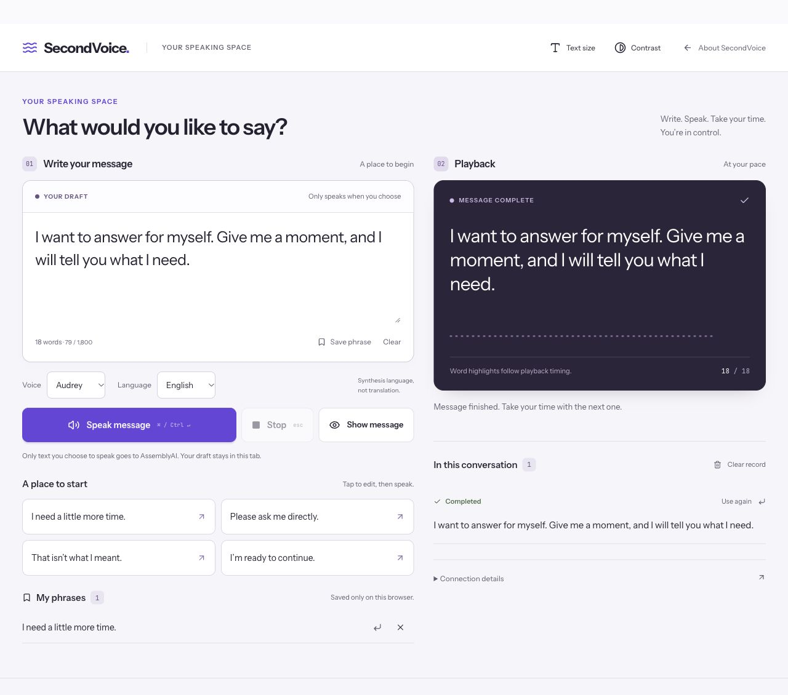
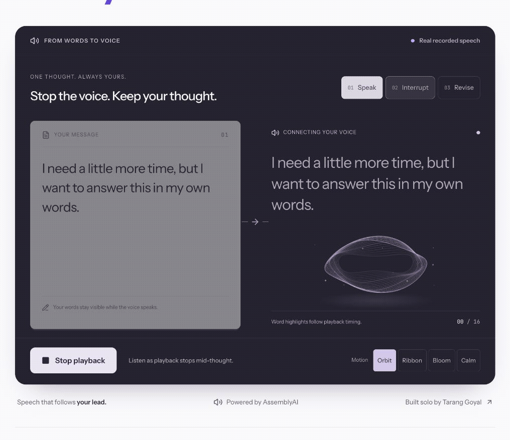
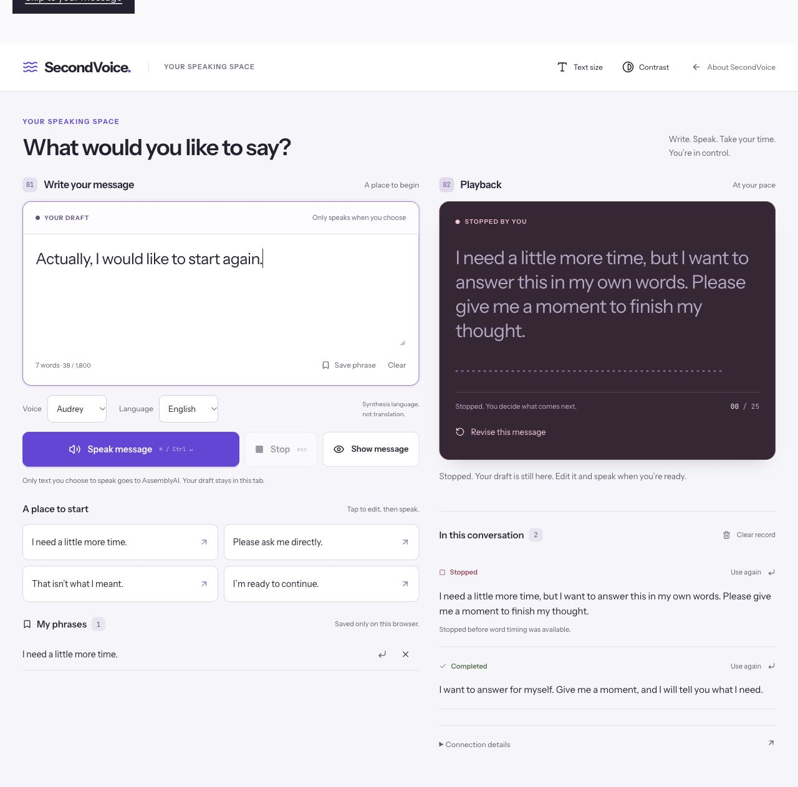
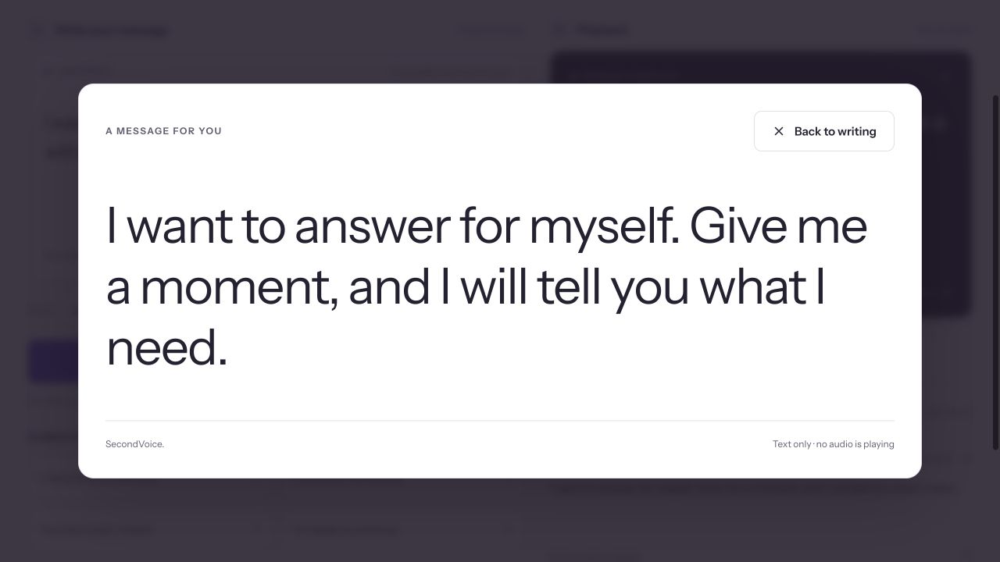
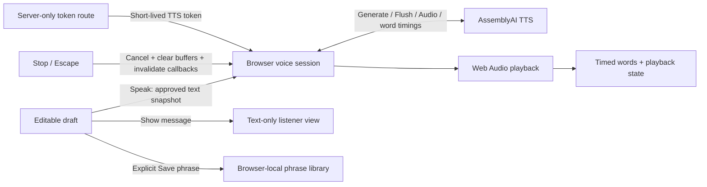

<div align="center">


# SecondVoice

### A voice for what you mean.

For moments when speaking takes more. Find your words, speak them aloud, and change your mind.

**Winner · AssemblyAI Hack into Speech Hackathon**<br />
Built solo by [Tarang Goyal](https://github.com/taranggoyal70).

[**Open SecondVoice ↗**](https://secondvoice-green.vercel.app/speak) · [Hear an example](https://secondvoice-green.vercel.app/#experience) · [The experience](#your-words-your-pace) · [How it works](#behind-the-voice) · [Run locally](#make-room-for-your-own-words)

<br />

<a href="https://secondvoice-green.vercel.app"></a>

<sub>No account. No microphone. You choose every word.</sub>

</div>

## Your words. Your pace.

A conversation has pauses, corrections, and second thoughts. SecondVoice gives the speaker a place to write, a voice to speak with, and a way to stop when the words no longer feel right.

1. **Write a thought.** Start with a blank page, choose a starter phrase, or reuse your own saved words.
2. **Speak when you’re ready.** AssemblyAI streams speech from the exact message you approve.
3. **Make room for the next thought.** Keep editing while the current message plays. The draft and the playing message are separate.
4. **Stop. Revise. Continue.** Stop or Escape clears playback. Your next draft stays intact.



<sub>Captured from the production build after real AssemblyAI synthesis. These are product screenshots, not generated interface mockups.</sub>

## A second thought should have a place to go

The landing page lets you hear three moments: **Speak → Interrupt → Revise**. Word highlights follow the original recording’s playback clock. The interruption stops partway through the thought; the next chapter plays the revised message.

<a href="https://secondvoice-green.vercel.app/#experience"></a>

<sub>Actual browser capture of the labeled recorded example. The GIF is silent; open the example to hear the real AssemblyAI audio. The example uses saved recordings and makes no live synthesis requests.</sub>

In the speaking workspace, **Stop is a real cancellation**. It sends the provider’s cancel frame, stops queued Web Audio buffers, closes the session, and invalidates late callbacks. It does not simply change a label or mute a looping demo.

<details>
<summary><strong>See the real interruption state</strong></summary>
<br />


The stopped message remains available through **Revise this message** or **Use again**. The displayed timed words are best-effort; they do not prove exactly what another person heard.
</details>

## Sometimes, showing the words is enough

Choose **Show message** to give the person beside you a large, readable view. Opening it stops any active speech. Escape or **Back to writing** returns to the draft, with keyboard focus restored by the native dialog.



Once the workspace is open, this view does not need a synthesis request. If the network drops, you can keep writing and showing text. SecondVoice is not currently an installable offline app.

## Useful in the small moments

| What you need | What SecondVoice does |
| :--- | :--- |
| **Words you use often** | Save up to 12 phrases on this browser. Tap to edit before speaking; remove them whenever you choose. |
| **A next thought** | Edit the next draft while the approved message plays. Playback keeps its original text. |
| **A do-over** | Undo an accidental draft clear, revise a stopped message, or bring a previous turn back into the editor. |
| **Readable controls** | Larger message text, high contrast, visible keyboard focus, and a native modal listener view. |
| **A phone-sized workspace** | A single-column layout and an active-playback Stop control that stays at the bottom of the screen. |
| **English or Spanish speech** | English voices Audrey, Titus and Yasmin; Spanish voice Constanza. Language selects synthesis, not translation. |
| **A quiet fallback** | Show the message as text if live voice is unavailable. Drafts remain editable after a failed connection. |
| **A conversation record** | The most recent 20 completed or stopped turns, kept in memory for this page only. |

**Keyboard:** `⌘/Ctrl + Enter` speaks the draft. `Escape` stops playback; it also dismisses the listener dialog. `Tab` reaches the controls.

[See the phone layout with larger text and high contrast](assets/readme/mobile.png).

## Behind the voice



### The draft is not the playback

[`components/second-voice-studio.tsx`](components/second-voice-studio.tsx) takes a snapshot when Speak is pressed. Subsequent edits change the next draft, not the utterance already sent. A session generation check prevents cancelled or older callbacks from overwriting the current state.

### Received audio is not finished audio

[`lib/assemblyai/tts-session.ts`](lib/assemblyai/tts-session.ts) schedules 24 kHz PCM against the Web Audio clock. Network `FlushDone` does not mark the message complete until queued playback has finished. A suspended audio clock cannot falsely complete the turn. Word highlights are timing aids, not an audibility measurement.

### Saved only when you ask

[`lib/phrases.ts`](lib/phrases.ts) validates stored phrases, rejects duplicates, and bounds the library and message length. Explicit saves use `localStorage`; they are not encrypted and are accessible to someone using the same browser profile. Drafts and conversation history are not persisted. Live text goes to AssemblyAI only after Speak.

### The provider key stays on the server

[`app/api/tts/token/route.ts`](app/api/tts/token/route.ts) mints short-lived, TTS-only tokens. The connection window is 30 seconds and the session cap is 60 seconds; other AssemblyAI products are disabled for the token. Production issuance uses a shared Vercel Firewall SDK bucket. Cross-origin requests are rejected, and failed allowance checks refuse new tokens.

**Tradeoff:** the public demo shares a 30-session-per-hour allowance per region. Each utterance currently opens its own session. The allowance and duration limit are not a monetary spending cap or a production subscription system. Text display and recorded examples remain available when the demo allowance is exhausted.

## Make room for your own words

Requires **Node.js 24** and npm.

```sh
git clone https://github.com/taranggoyal70/secondvoice.git
cd secondvoice
npm ci
cp .env.example .env.local
npm run dev -- -p 4174
```

Open **http://localhost:4174** for the landing page or **http://localhost:4174/speak** for the workspace.

- Set `ASSEMBLYAI_API_KEY` in the ignored `.env.local` file to enable live synthesis.
- The recorded example and text-only controls can be explored without a provider key.
- On Vercel, configure the key as a sensitive server environment variable and enable the `secondvoice-public-sessions` Firewall SDK rule with the intended 30 requests/hour bucket. Missing production allowance configuration fails closed.
- Never put the provider key in a `NEXT_PUBLIC_` variable, a screenshot, or a commit.

## Checked, not assumed

```sh
npm run lint
npm test
npm run build
```

**10 automated checks** cover cancellation during token creation, late frames after closure, suspended playback clocks, cancelling queued audio, approved-message submission, phrase validation and limits, and production/development origin rules.

Browser verification for this version covered:

- Real English and Spanish synthesis and playback completion.
- Stopping a live utterance while a different next draft remains intact.
- Keyboard speech and Escape cancellation.
- Phrase save, reuse, reload persistence, and removal.
- Draft clear/undo and conversation clearing on reload.
- Text-only listener dialog, Escape dismissal, and focus return.
- Desktop and measured 390px mobile layouts, larger text, and high contrast.

The CSS honors reduced motion; reduced-motion OS behavior and assistive-technology testing with actual users remain follow-up validation. These checks do not establish clinical effectiveness or universal device support.

[Verification notes](docs/product-verification.md) · [AssemblyAI TTS documentation](https://www.assemblyai.com/docs/tts/getting-started/quickstart)

## Find the code

```text
app/
  page.tsx                    Public product page
  speak/page.tsx              Focused communication workspace
  globals.css                 Shared visual system and responsive layouts
  opengraph-image.tsx          Social-link preview
  api/tts/token/route.ts       Scoped token issuance and shared allowance
components/
  second-voice-studio.tsx      Draft, playback, listener view and phrase library
  recorded-demo.tsx           User-controlled recorded speech chapters
  brand.tsx                   Shared SecondVoice identity
lib/
  assemblyai/tts-session.ts    Streaming audio, word timing and cancellation
  phrases.ts                  Bounded browser-local phrase storage
  request-origin.ts           Same-origin validation
public/demo/                  Original AssemblyAI recordings and timing files
assets/readme/                Real product screenshots and browser capture
tests/                       Playback, lifecycle, phrases and origin checks
```

## Scope and credit

SecondVoice is an **assistive communication prototype**, built solo with AI-assisted development. It is not a clinically validated AAC system, emergency communication service, or substitute for an individually assessed communication aid. It uses typed input and stock voices; it does not include voice cloning, automatic rewriting, speech recognition, or an agent system.

Built with **Next.js, React, TypeScript, Web Audio, and AssemblyAI TTS**. The focus on interactive product storytelling takes inspiration from [Continuity](https://github.com/aiden-guan/continuity). SecondVoice’s interface, copy, and implementation are its own. No Continuity source or assets were incorporated.

<div align="center">
<br />
<strong>Made for the person speaking.</strong><br />
<a href="https://secondvoice-green.vercel.app/speak">Open SecondVoice ↗</a>
</div>
